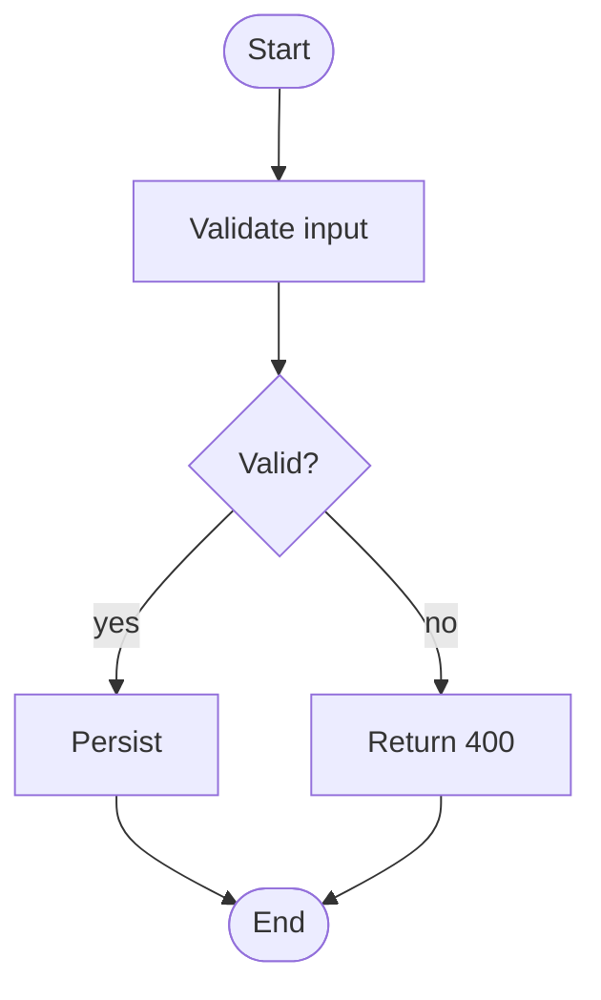

## When to use

You are asked for an `activity` diagram. Read `requirements/USER_STORIES.md`
for the actor goal, and `requirements/ACCEPTANCE_CRITERIA.md` for the decision
points the criteria imply.

## Rules

- Mermaid has no `activityDiagram` keyword: use `flowchart TD` for a
  top-down process.
- Node shapes: `[step]` process, `{decision}` decision, `([start])` / `([end])`
  for the terminals.
- Decision nodes have one outgoing edge per branch, each labelled:
  `B -->|yes| C`.
- Every `subgraph` (a phase or actor swimlane) is closed with `end`.
- Every step traces to a story or criterion; do not invent steps.

## Minimal worked example

## Common failure modes

- A cycle with no exit — the reader cannot tell where the process ends.
- Unlabelled decision branches → rejected by the structural check.
- Using a sequence diagram for a single-actor process: no messages, no sequence.
