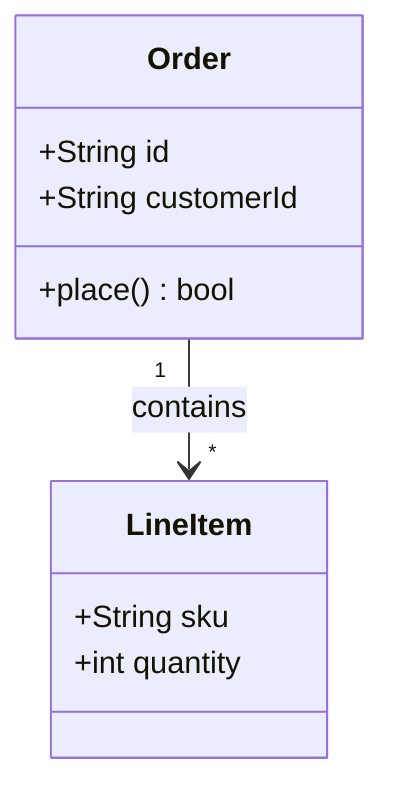

## When to use

You are asked for a `class` diagram. The single source is
`design/DATA_MODEL.md` — class names are entity names, members are its
attributes and operations.

## Rules

- First line is exactly `classDiagram`.
- Members live inside a `class Name { ... }` block, one per line, and every
  block is closed with `}`.
- Visibility prefixes: `+` public, `-` private, `#` protected, `~` package.
- Attribute form is `+Type name`; operation form is `+name() ReturnType`.
- Relationship cardinality is quoted: `"1"`, `"*"`, `"0..1"`.
- Every relationship carries a label after `:`.

## Minimal worked example

## Common failure modes

- Unclosed class block — the parser consumes every later line as a member.
- Unquoted cardinality (`Order 1 --> * LineItem`) → parse error.
- Inventing attributes the data model never declares. If DATA_MODEL.md has no
  attribute list for an entity, show the entity with its relationships only.
