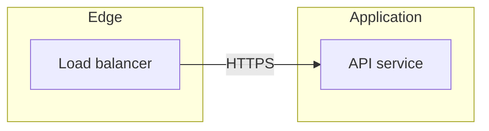

## When to use

You are asked for a `deployment` diagram. Read `design/ARCHITECTURE.md`: each
component becomes a node, each interface an edge.

## Rules

- Mermaid has no native deployment diagram: use `flowchart LR` with one
  `subgraph` per deployment node (host, cluster, environment).
- Every subgraph declares a display label: `subgraph app[Application]`.
- Every subgraph is closed with `end` on its own line.
- Every edge is labelled with the protocol: `LB -->|HTTPS| API`.
- Node names match component names in ARCHITECTURE.md.
- Show only nodes the architecture names. A database that appears in
  DATA_MODEL.md but not in ARCHITECTURE.md is a gap to report, not to fill.

## Minimal worked example

## Common failure modes

- Unclosed `subgraph` → the rest of the diagram nests inside it.
- Unlabelled edges: a deployment view without protocols answers nothing.
- Drawing cloud regions or replicas the architecture never mentions.
