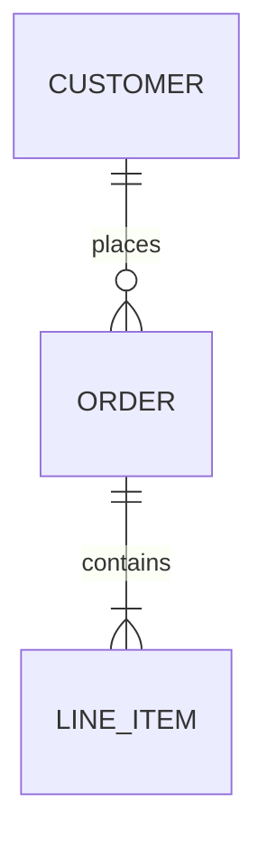

## When to use

You are asked for an `erd` diagram. Read `design/DATA_MODEL.md`; each entity
becomes an entity block and each relationship a cardinality line.

## Rules

- First line is exactly `erDiagram`.
- Cardinality tokens are limited to: `||--o{` (one to zero-more),
  `||--|{` (one to one-more), `}o--||` (zero-more to one),
  `|o--||` (zero-or-one to one), `||--||` (one to one).
- Every relationship carries a label after `:` (a verb: `places`, `contains`).
- Entity names in UPPER_SNAKE match the data model table names.
- Attribute blocks (`ENTITY { type name }`) are optional; include them only
  when DATA_MODEL.md lists a primary key worth showing.
- Every entity in the data model appears, at least as a bare name.

## Minimal worked example

## Common failure modes

- A relationship written without a label → rejected by the structural check.
- Inventing a join table the data model does not define. A many-to-many is
  still `A }o--o{ B : label` unless DATA_MODEL.md declares the join entity.
- Using `-->` (flowchart arrow) in an erDiagram — not valid there.
