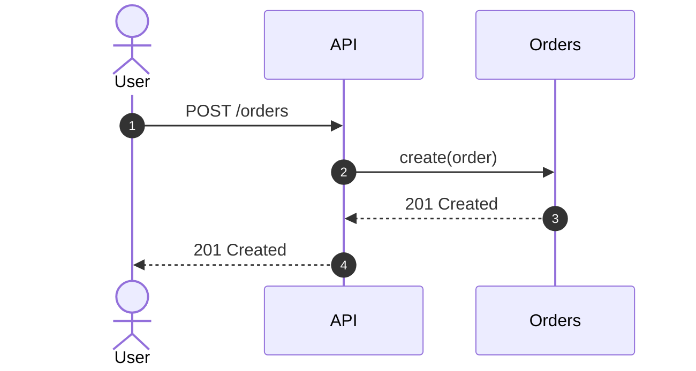

## When to use

You are asked for a `sequence` diagram. Read `design/API_SPEC.md` first —
every endpoint becomes at least one message pair — then `design/ARCHITECTURE.md`
for the component that serves it.

## Rules

- First line is exactly `sequenceDiagram`.
- Declare each participant once, before its first message:
  `actor User` for a human role, `participant API` for a service.
- Message arrows: `->>` request, `-->>` response, `-x` lost/undelivered.
- Every arrow carries a label after `:` — the HTTP method and path for the
  first hop, a short verb for internal hops.
- `autonumber` is optional and goes on the line after the header.
- No HTML tags, no parentheses inside labels (the parser rejects them).
- Participant names match the component names in ARCHITECTURE.md exactly.

## Minimal worked example

## Common failure modes

- A participant used in a message but never declared → parse error.
- Arrow without a label → rejected by the structural check.
- A self-call written as `A->>A` with no label reads as a mistake; label it.
- Modelling one endpoint twice with different participant sets: pick one path
  per endpoint and keep it.
