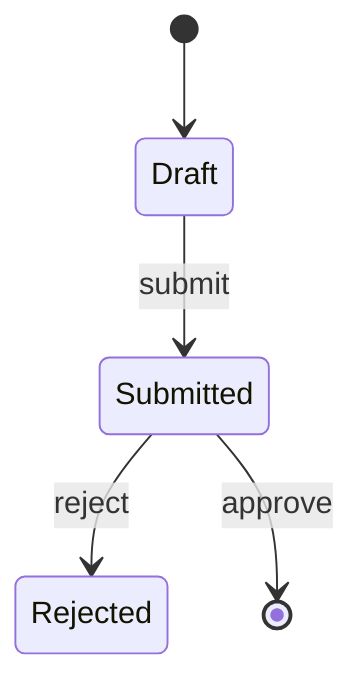

## When to use

You are asked for a `state` diagram. Read `requirements/ACCEPTANCE_CRITERIA.md`
for the Given/When/Then that names states, and `design/API_SPEC.md` for the
operations that cause transitions. Model ONE entity lifecycle per diagram.

## Rules

- First line is exactly `stateDiagram-v2`.
- `[*] --> State` is the initial transition and needs no label.
- Every other transition is `Source --> Target : event` — the event is the
  operation or criterion that causes it.
- Every non-initial state must be reachable from `[*]`.
- At least one path must end at `[*]` (a terminal state), or the lifecycle is
  incomplete — say so instead of inventing a terminal state.
- Composite states use `state Name { ... }` and must be closed.

## Minimal worked example

## Common failure modes

- Unlabelled transitions between real states → rejected by the structural check.
- Modelling two entities in one diagram: split into two files.
- Naming states after HTTP status codes instead of the domain lifecycle.
